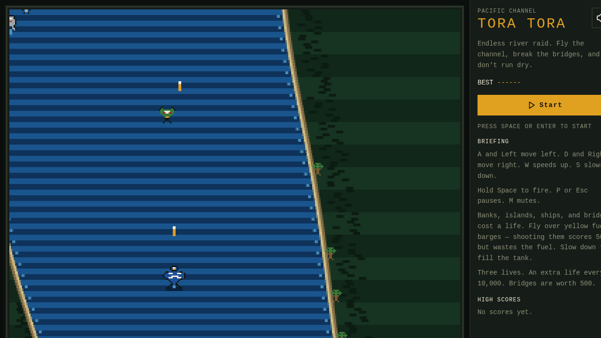
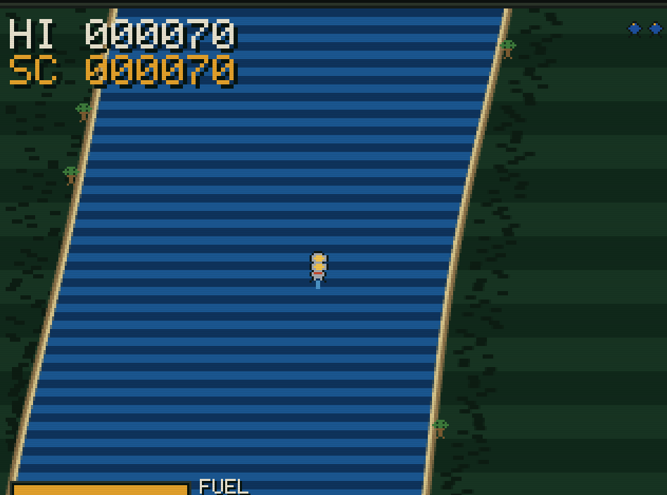
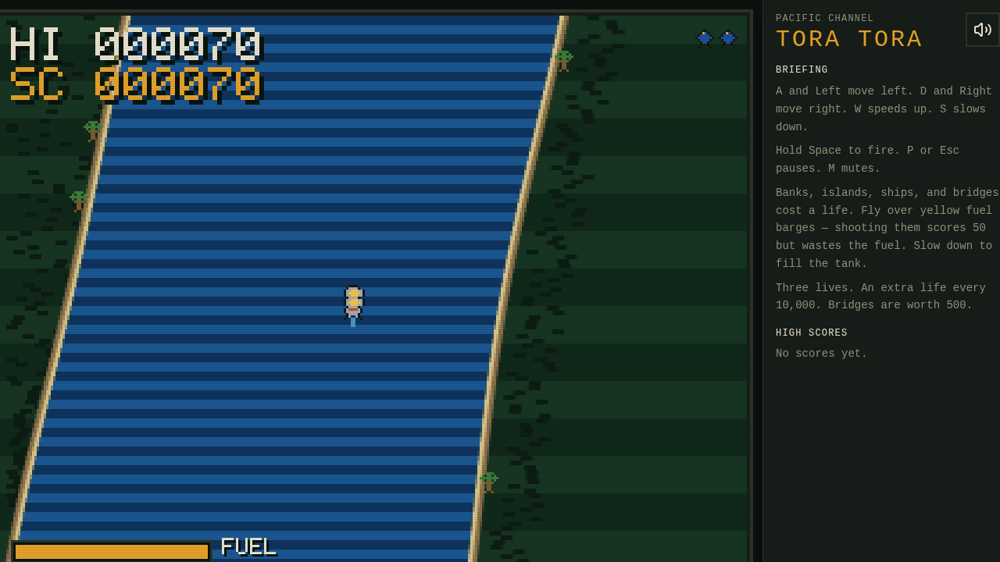

# Tora Tora

Endless Pacific river raid. Fly the channel, break the bridges, and don't run dry.





A top-down shooter in the River Raid tradition: a winding channel, fuel barges, enemy boats and planes, and bridges that have to come down before the river continues. The art is drawn in code at 320×240 and scaled with crisp pixels. No image files, no audio samples.



## Play

```bash
npm install
npm run dev
```

Open the local dev server, then press **Start**, **Space**, or **Enter**.

High scores stay in the browser (`localStorage`), top ten, three initials.

## Controls

| Action | Keyboard | Touch |
|---|---|---|
| Steer left | A or Left | Left |
| Steer right | D or Right | Right |
| Speed up | W or Up | Up |
| Slow down | S or Down | Down |
| Fire | Hold Space | Fire |
| Pause | P or Esc | |
| Mute | M, or the speaker button | |

On a phone the D-pad appears during a flight.

## Rules

- You start with **3 lives**. Another life every **10,000** points.
- Banks, islands, ships, planes, AA guns, and standing bridges cost a life.
- Fuel burns as you fly. **Fly over** a yellow barge to refill. Shooting a barge is worth 50 points and destroys the fuel.
- A bridge is a row of spans. Clear it (500 points) to keep going.
- The channel gets narrower, the scroll gets faster, and the traffic gets thicker the farther you fly.
- Running out of fuel costs a life.

## Install

It is an installable web app (home-screen icon, standalone window). It does not cache for offline play.

On an iPhone or iPad, open the published site in **Safari**, tap **Share**, then **Add to Home Screen**. On newer iOS, tap the puzzle-piece icon in the toolbar first, then Share.

## Stack

Canvas 2D, a fixed 60 Hz timestep, and the Web Audio API for the chiptune and the shots, explosions, and fuel tones. The shell is React 19 and TanStack Start.
